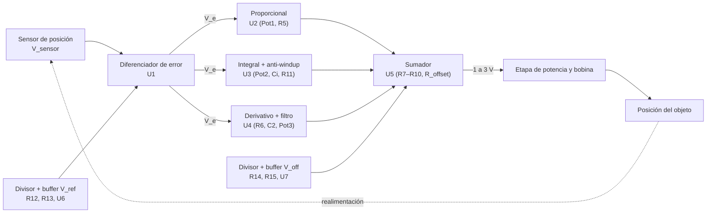
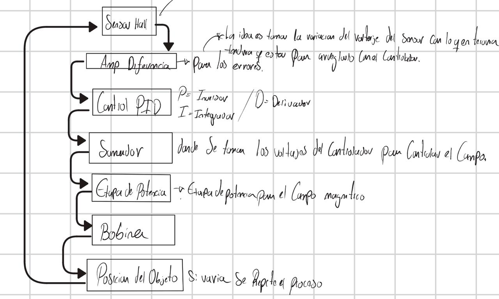
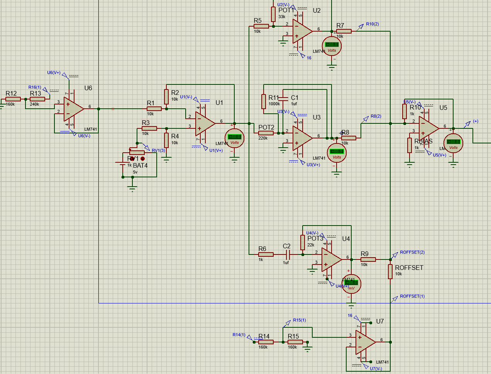
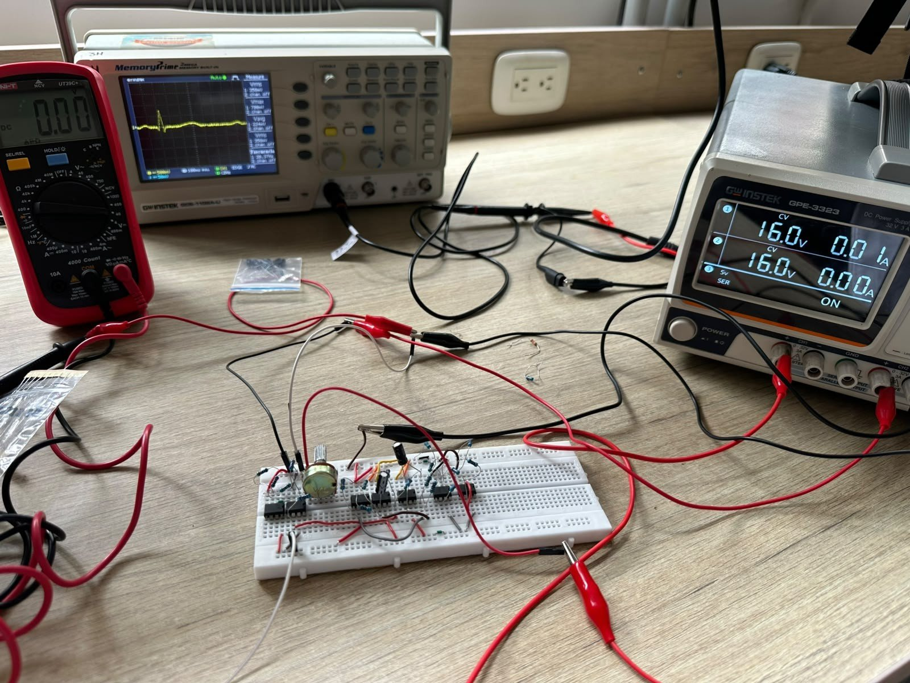
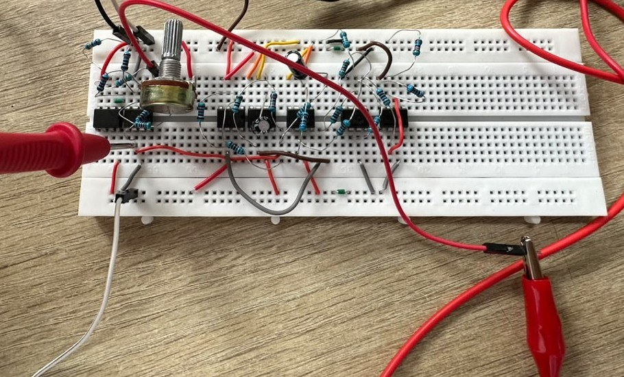
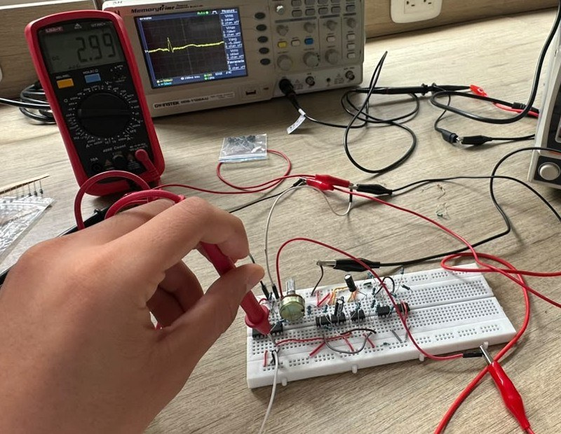

# Controlador PID analógico para levitación electromagnética


-brightgreen)


Diseño, cálculo, simulación, implementación y pruebas de un controlador **PID 100 % analógico**, construido solo con amplificadores operacionales LM741, para estabilizar la posición de un objeto en levitación por atracción electromagnética. El repositorio incluye el informe técnico completo (PDF y código fuente LaTeX), las figuras, la lista de materiales, las mediciones del montaje físico y su comparación con la teoría.

> **TL;DR (EN):** Fully analog, parallel PID controller built with LM741 op-amps for an electromagnetic levitation system: error amplifier, P / I (with anti-windup leak) / D (with high-frequency limiting) stages, and a summing stage with offset that produces a 1–3 V control signal. Reference voltages are generated by resistive dividers isolated with voltage-follower buffers. Includes hand calculations, Proteus simulation and an IEEE-style report written in LaTeX (Spanish).

📄 **Informe:** [`informe/Informe_PID_Analogico_Levitador.pdf`](informe/Informe_PID_Analogico_Levitador.pdf)

---

## Resumen del diseño

| Parámetro | Valor |
|---|---|
| Topología | PID en **paralelo** (P, I y D independientes; no en cascada) |
| Amplificadores | 7 × LM741 (U1–U7) |
| Alimentación de diseño | ±16 V |
| Salida del controlador | 1 V a 3 V (1 V = error nulo) |
| Referencia de posición | `V_ref` ≈ 2 V |
| Ganancias finales | `Kp = 2.2` · `Ki,max = 4.5` · `Kd,max = 22` |
| Frecuencias de diseño | integrador: `f_aw ≈ 0.2 Hz` · derivador: `f_c ≈ 150 Hz` |

**¿Por qué un PID?** Un levitador por atracción es inestable en lazo abierto (teorema de Earnshaw). Se descartaron el control todo-o-nada (fuerza discontinua), el P puro y el PD (ambos dejan error de estado estable o no lo eliminan) y se eligió el PID: P corrige el error instantáneo, I elimina el error de estado estable y D aporta el amortiguamiento que el sistema no tiene por sí mismo.

## Arquitectura



| Etapa | CI | Ecuación de diseño | Valores finales |
|---|---|---|---|
| Diferenciador de error | U1 | `V_e = (R2/R1)·(V_sensor − V_ref)`, `Av = 1` | R1 = R2 = R3 = R4 = 10 kΩ |
| Proporcional (P) | U2 | `V_P = −(Pot1/R5)·V_e` | R5 = 10 kΩ, Pot1 = 22 kΩ (`Kp = 2.2`) |
| Integral (I) | U3 | `V_I = −(1/(Pot2·Ci))∫V_e dt`, con fuga `R11 ‖ Ci`: `K_max = R11/Pot2` | Pot2 = 220 kΩ, Ci = 1 µF, R11 = 1 MΩ (`K_max = 4.5`) |
| Derivativo (D) | U4 | `V_D = −Pot3·C2·dV_e/dt`, `G_max = Pot3/R6`, `f_c = 1/(2π·R6·C2)` | R6 = 1 kΩ, C2 = 1 µF, Pot3 = 22 kΩ (`Kd,max = 22`) |
| Sumador | U5 | `V_PID = −(R10/R7·V_P + R10/R8·V_I + R10/R9·V_D + R10/R_offset·V_off)` | R7 = R8 = R9 = R_offset = 10 kΩ, R10 = 1 kΩ (ganancia 0.1 por rama) |
| Referencia `V_ref` | U6 | divisor + seguidor | R12 = 160 kΩ, R13 = 240 kΩ (desde 5 V → 2 V) |
| Offset `V_off` | U7 | divisor + seguidor | R14 = 96 kΩ (calculada; **pendiente de medir**), R15 = 160 kΩ |

La nomenclatura de las resistencias fue actualizada respecto a la primera versión del informe; la tabla de equivalencias está en [`docs/nomenclatura.md`](docs/nomenclatura.md).



## Problemas encontrados y cómo se resolvieron

1. **Saturación del sumador.** Con ganancia unitaria por rama, la salida teórica ante error máximo era de 23.24 V, muy por encima de los rieles. Se bajó la ganancia por rama a 0.1 (`R10`: 10 kΩ → 1 kΩ), se agregó un voltaje de offset para fijar el piso en 1 V y se redujo `Kp` de 3 a 2.2 para que el máximo converja a ≈ 3 V (3.02 V).
2. **Topología del integrador.** La resistencia de anti-windup se había conectado *en serie* con el capacitor, dejando la realimentación abierta en continua. Al colocarla en **paralelo** (`R11 ‖ Ci`) el integrador recuperó su comportamiento (salida nula para error nulo, rampa ante un escalón). Además se rediseñó `Ki` (ganancia DC máxima de 80 → 4.5) porque la original saturaba ante errores pequeños.
3. **Efecto de carga en los divisores.** Los divisores de `V_ref` y `V_off` entregaban menos voltaje del calculado al conectarse a la etapa siguiente. Se intercaló un seguidor de voltaje (U6 y U7) en cada uno.

## Simulación en Proteus

Cada etapa se simuló y midió con voltímetros virtuales antes del montaje. El esquemático completo está en [`informe/figuras/proteus_circuito_completo.png`](informe/figuras/proteus_circuito_completo.png) y el esquemático hecho a mano en [`informe/figuras/circuito_manuscrito.jpeg`](informe/figuras/circuito_manuscrito.jpeg).



## Resultados experimentales

Voltaje teórico vs. práctico por etapa, para error mínimo, medio y máximo (`V_sensor` = 0, 2 y 5 V con `V_ref` = 2 V). Las mediciones se tomaron con multímetro sobre el montaje en protoboard alimentado a ±16 V. Los datos completos, con error absoluto y relativo, están en [`datos/mediciones_practicas.csv`](datos/mediciones_practicas.csv).

| Etapa | Teórico mín. (V) | Teórico medio (V) | Teórico máx. (V) | Práctico mín. (V) | Práctico medio (V) | Práctico máx. (V) |
|---|---:|---:|---:|---:|---:|---:|
| Diferenciador | −2 | 0 | 3 | −2.02 | 0 | 2.99 |
| Proporcional (P) | 4.38 | −0.01 | −6.6 | 4.46 | −0.15 | −6.6 |
| Integral (I) | 9.14 | 0.07 | −13.5 | 6.22 | −0.32 | −13.22 |
| Derivativo (D) | −3.24 mV | −3.24 mV | −3.3 mV | 3 mV | 3 mV | 172 mV |
| Sumador | −0.35 | 1 | 3.01 | −0.04 | 1 | 2.96 |
| Divisor `V_ref` | 2 | 2 | 2 | 2 | 2 | 2 |
| Divisor `V_off` | −10.1 | −10.1 | −10.1 | −10.21 | −10.21 | −10.21 |

**Lectura rápida:**
- El diferenciador, el proporcional, el sumador y los divisores con buffer coinciden con lo calculado (error relativo ≤ 2 % donde el valor teórico es mayor que 0.5 V). La salida del sumador con error máximo es 2.96 V, dentro del rango de diseño de 1 V a 3 V, y con error medio es exactamente 1 V.
- La etapa integral con error mínimo da 6.22 V frente a 9.14 V teóricos (−32 %). Con ese valor práctico, el sumador resulta en −0.04 V, que es coherente con la salida medida.
- En la etapa derivativa, con entrada en DC, los valores son del orden de milivoltios; el de 172 mV con error máximo queda pendiente de analizar.

### Montaje físico

<p align="center">
  
</p>

| Circuito en protoboard | Medición a la salida del diferenciador (2.99 V) |
|:-:|:-:|
|  |  |

## Estructura del repositorio

```text
.
├── informe/
│   ├── informe_pid_analogico.tex        # código fuente del informe (IEEEtran)
│   ├── Informe_PID_Analogico_Levitador.pdf
│   └── figuras/                         # esquemáticos, cálculos a mano y diagrama de bloques
│       └── pruebas/                     # fotografías del montaje y de las mediciones
├── docs/
│   ├── nomenclatura.md                  # nomenclatura vigente y equivalencias con la versión anterior
│   └── errata-y-pendientes.md           # inconsistencias detectadas en el informe y tareas abiertas
├── hardware/
│   ├── lista_de_materiales.md
│   └── lista_de_materiales.csv
├── datos/
│   └── mediciones_practicas.csv         # teórico vs. práctico, con error absoluto y relativo
├── LICENSE
└── README.md
```

## Compilar el informe

Requiere una distribución de TeX Live con `IEEEtran`, `siunitx` y `booktabs`.

```bash
cd informe
latexmk -pdf informe_pid_analogico.tex
```

## Estado y próximos pasos

- [x] Diseño y cálculo de cada etapa
- [x] Simulación en Proteus
- [x] Informe técnico en LaTeX (formato IEEE)
- [ ] Medir `R14` (divisor de `V_off`) y registrar su valor final
- [x] Tomas de voltaje prácticas por etapa (error mínimo, medio y máximo)
- [x] Fotografías del montaje
- [ ] Analizar la desviación de la etapa integral con error mínimo y el valor de la etapa derivativa con error máximo
- [ ] Capturas de osciloscopio con la escala legible (pruebas con señal senoidal)
- [ ] Agregar el archivo del proyecto de Proteus
- [ ] Aplicar la [errata](docs/errata-y-pendientes.md) al informe (versión 1.1)

## Autor

**Brahiam Alberto Campiño Romero**: Ingeniería Electrónica, Universidad de Ibagué (Ibagué-Tolima, Colombia) · [@Brahiam18](https://github.com/Brahiam18)

## Licencia

[MIT](LICENSE)
