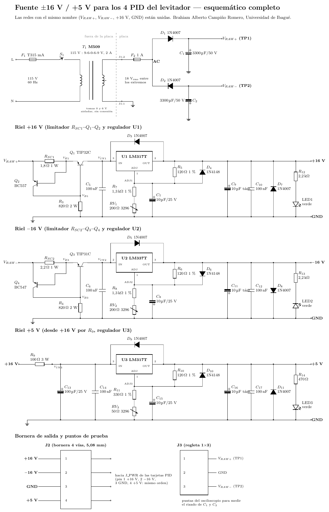

# Fuente de alimentación ±16 V / +5 V para los 4 PID del levitador

Proyecto de fuente (monografía *Electrónica Tomo II*, tema 3: reguladores de voltaje para fuentes DC). Alimenta los ocho TL074CN (±16 V), los cuatro sensores Hall y los divisores de `V_ref` (+5 V) de las dos tarjetas PID. Las bobinas usan una fuente aparte.

**Informe completo (IEEE, dos columnas):** [`informe/Informe_Fuente_Alimentacion.pdf`](informe/Informe_Fuente_Alimentacion.pdf)



## Resumen del diseño
| Bloque | Solución |
|---|---|
| Transformador | M509 115 V : 9‑6‑0‑6‑9 V / 2 A. Se usa el devanado completo de **18 V** (extremos de 9 V); las tomas 0 y 6 V quedan aisladas |
| Rectificador | Media onda doble: D1 para +, D2 para − (1N4007) |
| Filtro | C1 = C2 = 3300 µF / 50 V (rizado de 1,5 V_pp como máximo, valle ≥ 20,4 V con la red al −10 %) |
| Limitador | Antes de cada regulador, transistor de paso + sensor (Fig. 3‑26 y ec. 3.27 de la monografía): R_SC1 = 1,8 Ω → **0,39 A** en +16 V; R_SC2 = 2,2 Ω → **0,32 A** en −16 V |
| Reguladores | U1 LM317 (+16 V) y U2 LM337 (−16 V) con R1 = 120 Ω, R2 = 1,3 kΩ + trimmer de 200 Ω (ajuste de 14,9 a 17,0 V) |
| +5 V | U3 LM317 alimentado desde +16 V por R9 = 100 Ω / 3 W (corto: 0,145 A; filtro RC de 15,9 Hz). Ajuste de 4,70 a 5,23 V |
| Protecciones | F1 T315 mA (primario), F2 1 A (secundario), limitadores, protección térmica interna, diodos OUT→IN, ADJ→OUT y de polaridad inversa en las salidas |
| Disipadores | Q1+U1 y Q3+U2: un disipador de ≤ 5 °C/W por par, con mica. U3 no necesita disipador |

Simulación (ngspice): 16,00 / −16,00 / 5,00 V; rizado < 0,4 mV_pp; regulación de carga de 0,12 %; 8,5 mV de variación con la red al ±10 %; corrientes de corto de 0,39 / 0,33 / 0,14 A, con recuperación automática.

## Carpetas
| Carpeta | Contenido |
|---|---|
| `informe/` | Informe en LaTeX (IEEEtran) y PDF, con sus figuras |
| `calculos/` | `calculos.py`: todos los cálculos del diseño. `resultados_calculos.json`: sus resultados |
| `esquematicos/` | Esquemáticos por etapa y completo (circuitikz: PDF, PNG y fuente `.tikz`) |
| `simulacion/` | Netlist, modelos, script de ngspice, gráficas y resultados |
| `hardware/pcb/` | **EAGLE/Fusion** (`fuente.sch`, `fuente.brd`), **cobre espejado 1:1**, hoja de ensamble, puentes, guía de conexión y generador |
| `hardware/` | Lista de materiales (`.md` y `.csv`) |
| `pruebas/` | Plan de pruebas y tabla de mediciones para llenar (`mediciones.csv`) |

## Conexión rápida
- Secundario del M509: un extremo de 9 V a **J1‑1 (GND)** y el otro a **J1‑2 (AC)**.
- **J2** (+16 / −16 / GND / +5) va a `J_PWR` (pines 1‑2‑3‑4) de una tarjeta PID. La segunda tarjeta se une a la primera por su `J_PWR`.
- GND y PGND se unen **solo** en un `JP_GND` de las tarjetas PID, nunca en esta fuente.

## Recompilar
```bash
cd calculos && python3 calculos.py
cd ../simulacion && python3 simular.py              # requiere ngspice
cd ../informe && latexmk -pdf informe_fuente.tex    # requiere IEEEtran y circuitikz
cd ../hardware/pcb/generador && python3 build.py placa_ruteada.json ..   # requiere shapely y matplotlib
```
