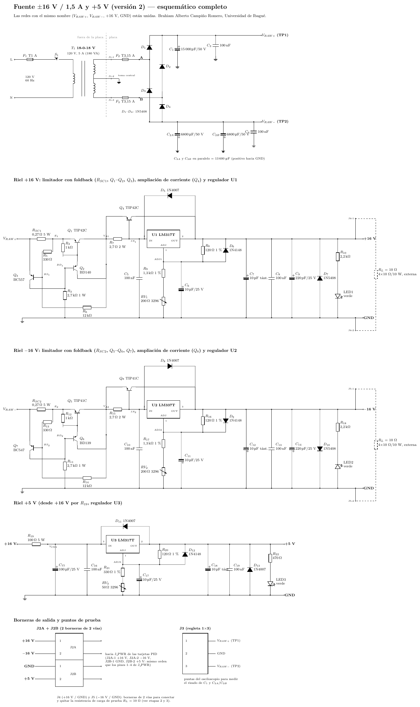

# Fuente lineal ±16 V / 1,6 A y +5 V con protección anticorto (foldback)

> **Nota:** esta carpeta se mantiene por referencia. El proyecto de la fuente sigue en su propio repositorio: [Fuente 1.6A ±16 V / 5 V con anticorto](https://github.com/Brahiam18/Fuente-1.6A--16v-5v-con-anti-corto-en-solo-un-fuente-a-la-vez-carga-y-sin-carga).

Fuente de alimentación lineal regulada diseñada para los 4 controladores PID analógicos de un levitador magnético ([repositorio del PID](https://github.com/Brahiam18/controlador-pid-analogico-levitador)). El trabajo de la monografía *Electrónica Tomo II* (A. Zambrano Zabaleta, 2020), tema 3: reguladores de voltaje para fuentes DC.

- **±16 V hasta 1,6 A** por riel, comprobados sobre una carga de prueba **removible** (R_L = 10 Ω en J4 o J5), **un riel a la vez**. Se mide con carga y sin carga.
- **+5 V / 57 mA** para los sensores Hall y las referencias, tomado del +16 V.
- **Protección anticorto con foldback**: limita a ≈ 2,4 A en sobrecarga y baja a 0,3–0,9 A en cortocircuito (según la red). Aguanta el corto indefinidamente con el disipador indicado y se recupera sola al quitarlo, incluso con R_L conectada.
- Reguladores **LM317 / LM337** (ya disponibles) con **ampliación de corriente** por TIP42C / TIP41C (Fig. 3-21 de la monografía).

**Informe completo (IEEE, dos columnas):** [`informe/Informe_Fuente_Alimentacion.pdf`](informe/Informe_Fuente_Alimentacion.pdf)



## Diseño (versión 2.2)
| Bloque | Solución |
|---|---|
| Transformador | **18-0-18 V / 5 A**, primario 120 V, toma central a GND. El de 3 A no regula con la red baja; el de 2 A trabajaría al ≈ 115 % de su corriente (2,3 A rms por mitad) |
| Rectificador | Puente D1–D4 1N5408, onda completa (120 Hz) para los dos rieles |
| Filtro | C1 = 15 000 µF (+) y C2A ‖ C2B = 2 × 6800 µF (−), 50 V, reutilizados |
| Limitador | R_SC = 0,27 Ω / 5 W, Darlington TIP42C + BD140 (TIP41C + BD139 en −16 V), sensor BC557 (BC547) y divisor de foldback **R5 = R13 = 330 Ω**, R6 = R14 = 12 kΩ |
| Ampliación | R7 = R7A ‖ R7B y R15 = R15A ‖ R15B: 2 × 5,6 Ω / 1 W en paralelo (2,8 Ω; o una sola de 2,7 Ω / 1 W) + TIP42C (TIP41C). El LM317 lleva solo ≈ 0,38 A |
| Reguladores | U1 LM317 (+16 V), U2 LM337 (−16 V): R1 = 120 Ω, R2 = 1,3 kΩ + trimmer 200 Ω; U3 LM317 (+5 V) desde +16 V por R19 = 100 Ω / 5 W |
| Protecciones | F1 T1 A (primario), F2/F3 T3,15 A (secundario), foldback, R19, protección térmica interna, diodos OUT→IN, ADJ→OUT y de polaridad inversa |
| Disipadores | Uno de **≤ 2 °C/W por riel** (≈ 100 × 69 × 36 mm) para Q1, Q2, Q4, U1 (y Q5, Q6, Q8, U2), todos con mica y buje |

### Cambios de la versión 2 a la 2.1 (validación en Proteus)
1. **Transformador de 3 A → 5 A.** Con el de 3 A, R_L puesta y la red al −10 %, la salida caía a 14,6 V. La resistencia del devanado le quitaba el margen al regulador. Con el de 5 A regula.
2. **R5 y R13: 270 Ω → 330 Ω.** El sensor del modelo de Proteus conduce con ≈ 0,8 V, y con 270 Ω el corto con red baja daba 1,26 A (≈ 23 W en Q1). Con 330 Ω da 0,89 / 0,60 / 0,28 A con red baja / nominal / alta, y la fuente sigue arrancando y recuperándose con R_L.
3. **J2** pasó a ser **dos borneras de 2 vías** (J2A + J2B) encajadas, con los mismos pads.
4. **Pistas a 45°** en la placa: 225 esquinas biseladas y holgura mínima de 0,59 mm.

### Cambios de la versión 2.1 a la 2.2
1. **R7 y R15** pasan a ser **dos resistencias de 5,6 Ω / 1 W en paralelo** (2,8 Ω), porque la de 2,7 Ω no siempre se consigue. Cada una disipa ≤ 0,18 W. Con una de 2,7 Ω / 1 W basta montar R7A y R15A.
2. **15 puntos de prueba** (TP1–TP15) en la placa para medir con el multímetro las tensiones de cada etapa y la corriente de cada riel (caída en R_SC). Ver `pruebas/plan_de_pruebas.md`.
3. La placa se recolocó y se ruteó de nuevo: 8 puentes, 234 esquinas a 45°, holgura mínima 0,59 mm y ninguna pista a menos de 1 mm del borde.

### Resultados
| Prueba | ngspice | Proteus |
|---|---|---|
| +16 V con R_L (1,6 A), red nominal | 15,98 V | 15,9 V / 1,59 A |
| Regulación de carga | 0,08 % | — |
| Rizado de salida | 0,1 mV_pp | — |
| Corto +16 V (red −10 % / nominal / +10 %) | 0,93 / 0,67 / 0,43 A (con 1 V de salida); 0,32 A en corto franco con red nominal | 0,89 / 0,60 / 0,28 A |
| Recuperación del corto con R_L | 15,98 V | 15,9 V |

## Carpetas
| Carpeta | Contenido |
|---|---|
| `informe/` | Informe en LaTeX (IEEEtran) y PDF, con sus figuras |
| `calculos/` | `calculos.py`: todos los cálculos del diseño, y sus resultados en JSON |
| `esquematicos/` | Esquemáticos por etapa y completo (circuitikz: PDF, PNG y `.tikz`) |
| `simulacion/` | Netlist, modelos y script de **ngspice**, gráficas y resultados. `simulacion/proteus/`: proyecto de **Proteus** (`.pdsprj`) |
| `hardware/pcb/` | **EAGLE / Fusion** (`fuente.sch`, `fuente.brd`), **cobre espejado 1:1** para planchar, hoja de ensamble, puentes y generador |
| `hardware/` | Lista de materiales (`.md` y `.csv`) |
| `pruebas/` | Plan de pruebas y tabla de mediciones para llenar |

## Conexión rápida
- Secundario 18-0-18 V: extremo A a **J1-1**, toma central a **J1-2 (GND)**, extremo B a **J1-3**.
- **J2A** (+16, −16) y **J2B** (GND, +5) van a `J_PWR` (pines 1-2-3-4) de una tarjeta PID; la segunda tarjeta se une por su `J_PWR`.
- **J4** (+16 V, GND) y **J5** (−16 V, GND): carga de prueba R_L = 10 Ω (4 × 10 Ω / 10 W en serie-paralelo), solo para la prueba de 1,6 A y **en un riel a la vez**.
- GND y PGND (bobinas) se unen solo en un `JP_GND` de las tarjetas PID, nunca en esta fuente.

## Recompilar
```bash
cd calculos && python3 calculos.py
cd ../simulacion && python3 simular.py                  # requiere ngspice
cd ../informe && latexmk -pdf informe_fuente.tex        # requiere IEEEtran y circuitikz
cd ../hardware/pcb/generador && python3 build.py placa_ruteada.json ..   # requiere shapely y matplotlib
```

Autor: Brahiam Alberto Campiño Romero — Programa de Ingeniería Electrónica, Universidad de Ibagué.
