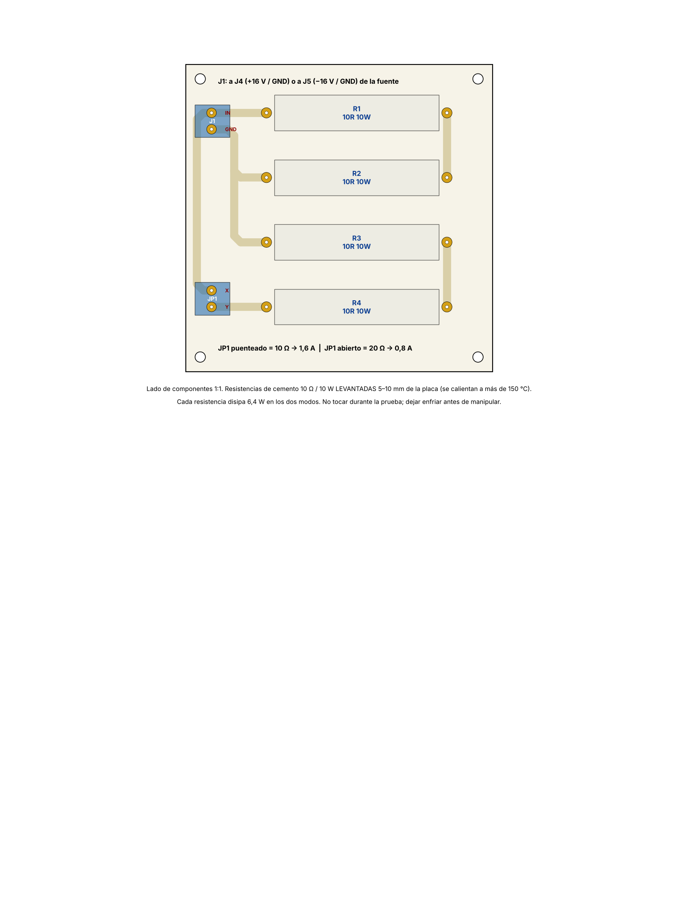

# Placa de la carga de prueba R_L (10 Ω / 20 Ω)

Placa de **una cara** de **95 × 95 mm** para las 4 resistencias de cemento de **10 Ω / 10 W** de la carga de prueba. No uses la protoboard para esto: sus contactos aguantan alrededor de 1 A y las resistencias pasan de 150 °C.

## Circuito
(R1 + R2) ‖ (R3 + R4). **JP1** es una bornera de 2 vías que elige la carga:

| JP1 | Resistencia | Corriente con 16 V | Potencia en cada resistencia |
|---|---|---|---|
| **Puenteado** (alambre de 18 AWG o interruptor de 3 A) | 10 Ω | **1,6 A** (corriente completa) | 6,4 W |
| **Abierto** | 20 Ω (solo R1 + R2) | **0,8 A** (media corriente) | 6,4 W en R1 y R2; R3 y R4 frías |

**J1** (bornera de 2 vías) va con un cable de 18 AWG a **J4** (+16 V / GND) o a **J5** (−16 V / GND) de la fuente. La polaridad no importa.

## Archivos
| Archivo | Para qué sirve |
|---|---|
| `cobre_espejado_1a1.pdf` | Cara de cobre espejada a 1:1 para planchar (la regla debe medir 50 mm) |
| `ensamble_1a1.pdf` | Lado de componentes a 1:1 |
| `carga.sch`, `carga.brd` | Formato EAGLE para Fusion (cargar los dos juntos) |
| `generar.py` | Genera todo lo anterior (`python3 generar.py`) |

## Reglas y montaje
- Pistas de 2,5 mm con quiebres a 45°; separación mínima entre redes de 1,75 mm; ninguna pista a menos de 2 mm del borde.
- Pads de 3,2 mm con taladro de 1,2 mm para las patas de las resistencias (55,88 mm entre agujeros) y de 1,3 mm para las borneras.
- **Monta las resistencias levantadas 5–10 mm** de la placa, con las patas dobladas en ángulo recto. Quedan separadas unos 9 mm entre sí para que se ventilen.
- Estaña las pistas.
- Pon separadores M3 en los 4 agujeros para que la placa no quede apoyada sobre la mesa.
- **No las toques durante la prueba** y espera a que se enfríen antes de cambiar el puente.

## Materiales
| Cant. | Pieza |
|---|---|
| 4 | Resistencia de cemento 10 Ω / 10 W |
| 2 | Bornera de tornillo 2 vías, paso 5,08 mm (J1, JP1) |
| 1 | Baquela una cara 10 × 10 cm |
| 4 | Separadores M3 de 10 mm con tornillo |
| — | Cable de 18 AWG para la conexión a la fuente y para el puente de JP1 |
