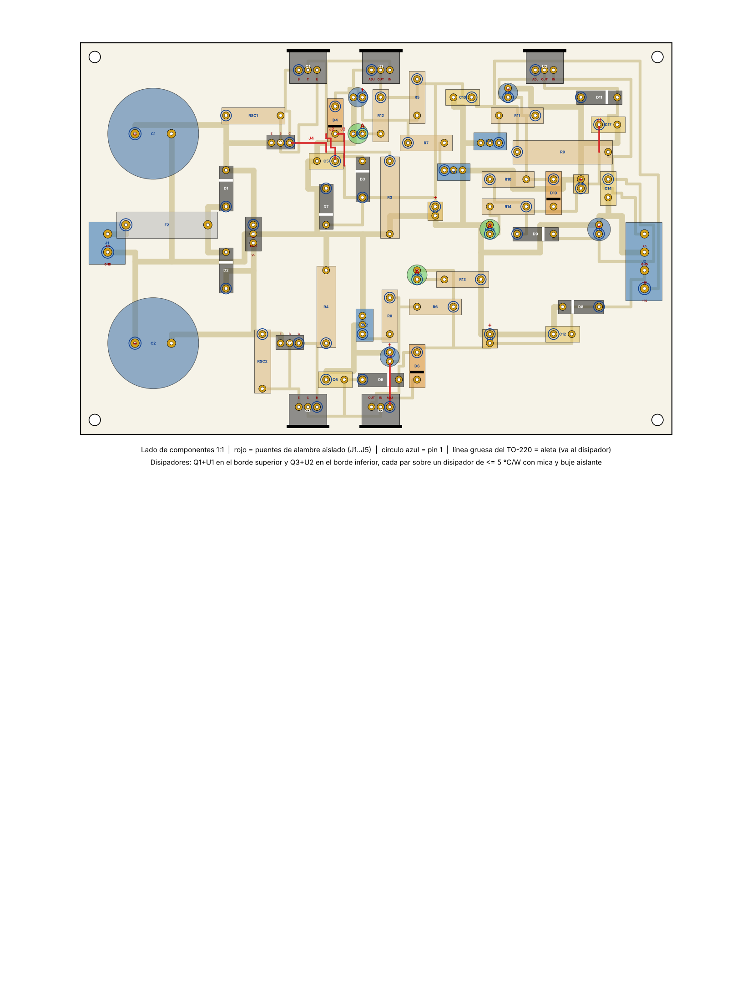

# Placa de la fuente ±16 V / +5 V

Placa de **una sola cara** (cobre inferior) de **165,1 × 109,2 mm**, con márgenes de sobra en una baquela de 20 × 15 cm. Se fabrica por transferencia de tóner o con película fotosensible. Lleva **5 puentes de alambre** del lado de componentes, ninguno en las redes de potencia.

| Archivo | Para qué sirve |
|---|---|
| `fuente.sch` y `fuente.brd` | Esquemático y placa en formato EAGLE. En Fusion: *Cargar* los dos archivos juntos con "Crear diseño de la electrónica" marcado. Las piezas están en la biblioteca propia `fuente16`. El esquemático conecta por **etiquetas de red**; el dibujo legible está en `../../esquematicos/` |
| `cobre_espejado_1a1.pdf` | Cara de cobre **espejada** a escala 1:1, para planchar o insolar |
| `ensamble_1a1.pdf` | Página 1: lado de componentes a 1:1 (referencias, pin 1, puentes en rojo). Página 2: vista ampliada en A4 horizontal con referencia y valor |
| `puentes.md` | Lista de los 5 puentes con red, longitud y extremos |
| `generador/` | Código en Python que hace la colocación, el ruteo, la verificación y la exportación (`python3 buscar.py 1,2,3,4 placa.json` y luego `python3 build.py placa.json ..`) |

## Reglas de diseño (verificadas por `verify.py` y `xmlcheck.py`)
- Pistas de 0,8 mm. Las redes de corriente alta (`ACIN`, `AC`, `VRAWP`, `VRAWN`, `GND`) van en 1,6 mm.
- Pads de 2,0 mm, y de 2,4 mm en las borneras, el portafusible y los condensadores grandes.
- Taladros: 0,9 mm en general; 1,0 mm para TO‑220, 1N4007 y resistencias de potencia; 1,1 mm para C1, C2 y R9; 1,3 mm para borneras y portafusible; 3,2 mm para los 4 agujeros de montaje.
- Separación mínima entre cobres de redes distintas: **0,40 mm**, medida sobre la geometría final.
- Las 24 redes están completas, sin cortos, y el `.sch` y el `.brd` son consistentes.

## Fabricación
1. Imprimir `cobre_espejado_1a1.pdf` **sin escalar** ("tamaño real"). La regla de abajo debe medir 50 mm.
2. Transferir, atacar con cloruro férrico y taladrar. El punto blanco de cada pad marca el centro.
3. Revisar con el multímetro, antes de soldar, que no haya cortos: `+16V`–`GND`, `-16V`–`GND`, `+5V`–`GND`, `VRAWP`–`GND`, `VRAWN`–`GND` y `+16V`–`-16V`.
4. Soldar en este orden: primero los puentes (alambre aislado), luego resistencias y diodos, después TO‑92, trimmers, condensadores pequeños, LED, borneras, portafusible, C1 y C2, y al final los TO‑220 con su disipador.

## Disipadores (importante)
- **Q1 (TIP32C) + U1 (LM317T)** van en el borde superior y **Q3 (TIP31C) + U2 (LM337T)** en el borde inferior. Cada par comparte un disipador de **≤ 5 °C/W** que sobresale del borde de la placa.
- La aleta de un TO‑220 está conectada eléctricamente a su pin central (colector o salida). Por eso **cada pieza lleva mica (o silicona) y buje aislante**. Después de montarlas, comprobar con el óhmetro que entre la aleta y el disipador haya circuito abierto.
- **U3** (+5 V) disipa unos 0,3 W y no necesita disipador.

## Guía de conexión

| Desde | Hacia | Nota |
|---|---|---|
| Red 115 V (L) | Fusible F1 T315 mA → interruptor S1 → primario del M509 | Fuera de la placa, con los empalmes aislados |
| Red 115 V (N) | Otro extremo del primario | |
| Extremo de 9 V del secundario (uno) | **J1‑1 (GND)** | |
| Otro extremo de 9 V del secundario | **J1‑2 (AC)** | Se usa el devanado completo de 18 V. **No conectar las tomas 0 V ni 6 V**: aislarlas |
| J2‑1 +16 V, J2‑2 −16 V, J2‑3 GND, J2‑4 +5 V | `J_PWR` pines 1, 2, 3 y 4 de **una** tarjeta PID; la otra tarjeta se une a la primera por su `J_PWR` | Mismo orden de pines en los dos lados |
| J3 (V_RAW+, GND, V_RAW−) | Osciloscopio | Medición del rizado de C1 y C2 |

**Tierras:** la tierra de esta fuente (GND) es solo de señal. La fuente de las bobinas (`VBOB`/`PGND`) va aparte. GND y PGND se unen **en un solo punto**, el puente `JP_GND` soldado en una sola de las cuatro etapas de las tarjetas PID. No unir GND y PGND en ningún otro lugar, tampoco dentro de esta fuente.
