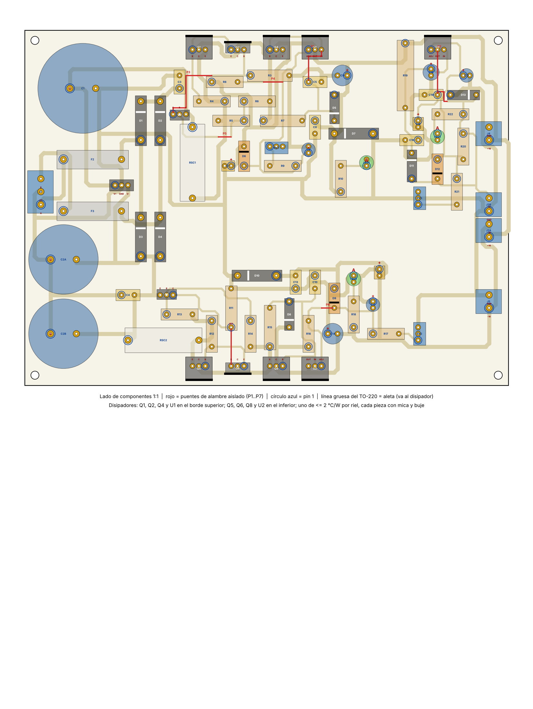

# Placa de la fuente ±16 V / 1,6 A y +5 V (versión 2.2)

Placa de **una sola cara** (cobre inferior) de **190,5 × 139,7 mm**, que cabe en una baquela de 20 × 15 cm. Se fabrica por transferencia de tóner o con película fotosensible. Lleva **8 puentes de alambre** (P1–P8) del lado de componentes, todos en redes de señal o de baja corriente. Pistas biseladas a 45° y salida J2 hecha con dos borneras de 2 vías (J2A y J2B).

**Cambios de la v2.2:** R7 y R15 son ahora **dos huellas de 1 W cada una** (R7A ‖ R7B y R15A ‖ R15B) para montar 2 × 5,6 Ω en paralelo (= 2,8 Ω). Si consigues la de 2,7 Ω / 1 W, monta solo R7A y R15A y deja R7B y R15B vacías. Además hay **15 puntos de prueba** (TP1–TP15) para el multímetro; para hacerles sitio la placa se recolocó y se ruteó de nuevo.

| Archivo | Para qué sirve |
|---|---|
| `fuente.sch` y `fuente.brd` | Esquemático y placa en formato EAGLE. En Fusion: *Cargar* los dos archivos juntos con "Crear diseño de la electrónica" marcado. Las piezas están en la biblioteca propia `fuente16`. El esquemático conecta por **etiquetas de red**; el dibujo legible está en `../../esquematicos/` |
| `cobre_espejado_1a1.pdf` | Cara de cobre **espejada** a escala 1:1, para planchar o insolar |
| `ensamble_1a1.pdf` | Página 1: lado de componentes a 1:1 (referencias, pin 1, puentes en rojo). Página 2: vista ampliada con referencia y valor |
| `puentes.md` | Lista de los 8 puentes con red, longitud y extremos |
| `generador/` | Código en Python que hace la colocación, el ruteo, la verificación y la exportación (`NO_TP=1 python3 buscar.py 3 placa.json`, luego `python3 incremental.py placa.json placa.json` para agregar los puntos de prueba y `python3 build.py placa.json ..`) |

## Reglas de diseño (verificadas por `verify.py` y `xmlcheck.py`)
- Pistas de 0,8 mm. Las redes de corriente alta (secundario `ACA`/`ACB`/`AC1`/`AC2`, `VRAWP`, `VRAWN`, `E1`, `E2`, `VA1`, `VA2`, `+16V`, `-16V`, `GND`) van en 1,6 mm.
- Pads de 2,0 mm, y de 2,6 mm en borneras, portafusibles, 1N5408, R_SC (5 W) y condensadores grandes.
- Taladros de 0,9 a 1,3 mm según la pieza (C1 de 15 000 µF: Ø ≤ 35 mm, 10 mm entre patas; C2A/C2B de 6800 µF: Ø 28 mm, 10 mm entre patas) y 3,2 mm para los 4 agujeros de montaje.
- Separación mínima entre cobres de redes distintas: regla de **0,40 mm**; en la placa final es de **0,59 mm**, medida sobre la geometría final.
- Ninguna pista a menos de 1 mm del borde y ningún puente a menos de 3 mm del borde de los disipadores.
- **Pistas a 45°**: las 234 esquinas de las pistas están biseladas (sin ángulos rectos), lo que mejora el grabado y reparte mejor la corriente. Solo quedan a 90° las uniones en T y los quiebres sobre un pad.
- Las 32 redes están completas, sin cortos, y el `.sch` y el `.brd` son consistentes.

## Fabricación
1. Imprimir `cobre_espejado_1a1.pdf` **sin escalar** ("tamaño real"). La regla de abajo debe medir 50 mm.
2. Transferir, atacar con cloruro férrico y taladrar. El punto blanco de cada pad marca el centro.
3. Estañar las pistas anchas (secundario, V_RAW, ±16 V y GND) para que soporten mejor los 1,6 A.
4. Revisar con el multímetro, antes de soldar, que no haya cortos: `+16V`–`GND`, `-16V`–`GND`, `+5V`–`GND`, `VRAWP`–`GND`, `VRAWN`–`GND` y `+16V`–`-16V`.
5. Soldar en este orden: primero los puentes (alambre aislado, calibre 22 AWG o más grueso), luego resistencias y diodos, después TO‑92, trimmers, condensadores pequeños, LED, borneras, portafusibles, C1, C2A y C2B, y al final los TO‑220/TO‑126 ya atornillados a su disipador.

## Puntos de prueba (TP1–TP15)
Pads rojos con el nombre de la red en `ensamble_1a1.pdf`. Punta negra del multímetro en **TP13, TP14 o TP15 (GND)**. Si quieres enganchar caimanes, suelda en cada pad un alambre 22 AWG doblado en U.

| TP | Red | Qué mides |
|---|---|---|
| TP1 / TP6 | V_RAW+ / V_RAW− | Salida del filtro: ±25 a ±28 V sin carga, ±23 a ±24 V con R_L |
| TP2 / TP7 | E1 / E2 | Después de R_SC: **corriente del riel** = (TP1 − TP2)/0,27 Ω (0,43 V ↔ 1,6 A) |
| TP3 / TP8 | V_A1 / V_A2 | Salida del limitador (colector del Darlington) |
| TP4 / TP9 | IN1 / IN2 | Entrada del regulador; TP4 − TP5 ≥ 2 V para que regule |
| TP5 / TP10 | +16 V / −16 V | Salidas (ajuste con RV1 / RV2) |
| TP11 / TP12 | V_IN5 / +5 V | Entrada (≈ 10 V) y salida (5,00 V, RV3) del regulador de +5 V |
| TP13–TP15 | GND | Referencia |

## Disipadores (importante)
- **Q1 (TIP42C), Q2 (BD140), Q4 (TIP42C) y U1 (LM317T)** van en el borde superior; **Q5 (TIP41C), Q6 (BD139), Q8 (TIP41C) y U2 (LM337T)** en el inferior. Cada grupo comparte un disipador de **≤ 2 °C/W** (por ejemplo un perfil aletado de unos 100 × 60 × 30 mm) que sobresale del borde de la placa.
- La aleta de cada pieza está conectada eléctricamente a uno de sus pines. Por eso **cada pieza lleva mica (o silicona) y buje aislante**. Después de montarlas, comprobar con el óhmetro que entre cada aleta y el disipador haya circuito abierto.
- **U3** (+5 V) disipa unos 0,3 W y no necesita disipador.

## Guía de conexión

| Desde | Hacia | Nota |
|---|---|---|
| Red 115 V (L) | Fusible F1 T1 A → interruptor S1 → primario del transformador | Fuera de la placa, con los empalmes aislados |
| Red 115 V (N) | Otro extremo del primario | |
| Secundario 18‑0‑18 V: extremo A, toma central, extremo B | **J1‑1**, **J1‑2 (GND)**, **J1‑3** | F2 y F3 (T3,15 A) están en la placa |
| **J2A**‑1 +16 V, J2A‑2 −16 V, **J2B**‑1 GND, J2B‑2 +5 V (dos borneras de 2 vías encajadas) | `J_PWR` pines 1, 2, 3 y 4 de **una** tarjeta PID; la otra tarjeta se une a la primera por su `J_PWR` | Mismo orden de pines en los dos lados |
| **J4‑1 (+16 V), J4‑2 (GND)** | Carga de prueba `R_L` = 10 Ω (4 × 10 Ω / 10 W en serie‑paralelo) | **Removible**: solo durante la prueba de 1,5 A |
| **J5‑1 (−16 V), J5‑2 (GND)** | Carga de prueba `R_L` | Un riel a la vez |
| J3 (V_RAW+, GND, V_RAW−) | Osciloscopio | Medición del rizado de C1 y C2 |

**Tierras:** la tierra de esta fuente (GND) es solo de señal. La fuente de las bobinas (`VBOB`/`PGND`) va aparte. GND y PGND se unen **en un solo punto**, el puente `JP_GND` soldado en una sola de las cuatro etapas de las tarjetas PID. No unir GND y PGND en ningún otro lugar, tampoco dentro de esta fuente.
