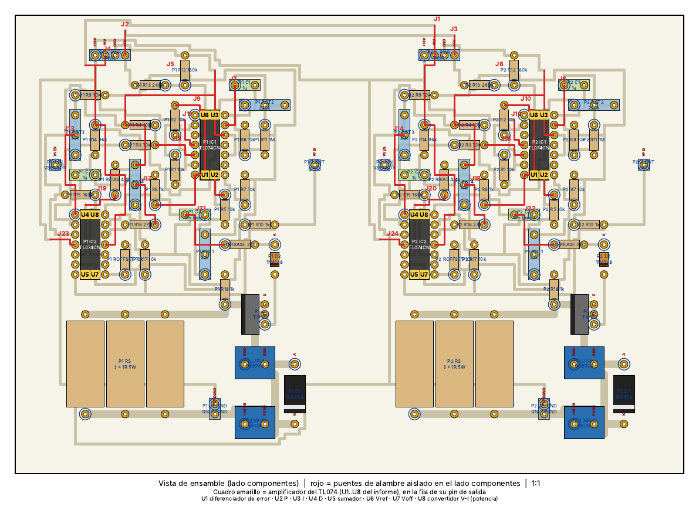
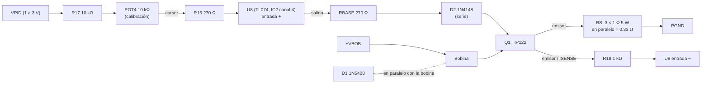

# Placa de 2 controladores PID analógicos con etapa de potencia

Placa de **una sola cara** para fabricar en baquela (transferencia de tóner o fotosensible) con **dos controladores PID independientes**. Para el levitador de cuatro bobinas se hacen **dos tarjetas iguales** (un solo plano, impreso dos veces). Cada controlador es idéntico al circuito del informe (2 × TL074CN por PID) y **trae su propia etapa de potencia** (convertidor tensión‑corriente con TIP122, banco de sensado de 3 × 1 Ω, protección y bornes para la bobina). Los dos PID de una tarjeta comparten los rieles de ±16 V, +5 V y GND; cada uno tiene su entrada de sensor (`VSEN`), su salida de control (`VPID`), su alimentación de bobina (`VBOB`/`PGND`) y su conexión de bobina.



| Dato | Valor |
|---|---|
| Tamaño de la placa | **170.2 × 116.8 mm** (17 × 11.7 cm): cabe en una baquela de 20 × 20 cm y el PDF se imprime 1:1 en una hoja A4 o Carta |
| Capas | 1 (cobre inferior) + puentes de alambre en el lado de componentes |
| Pistas de señal / pads / taladro | 0.7 mm / 2.0 mm / 0.9 mm (los pads de potencia usan 1.0 a 1.3 mm) |
| Pistas de potencia | 2.0 mm (`ISENSE`, `COILN`, `+VBOB`, `PGND`); unos 3.9 A con +10 °C de calentamiento, conviene **cubrirlas con estaño** |
| Separación mínima entre redes | 0.45 mm (medida sobre la geometría final) |
| Puentes de alambre | 24 en total, ninguno en redes de potencia; ver [`puentes.md`](puentes.md) |

## Archivos

| Archivo | Para qué sirve |
|---|---|
| [`pid2_levitador.sch`](pid2_levitador.sch) y [`pid2_levitador.brd`](pid2_levitador.brd) | Esquemático (una hoja por PID) y placa en formato EAGLE; Fusion los abre en Electronics |
| [`cobre_espejado_1a1.pdf`](cobre_espejado_1a1.pdf) | **Hoja de cobre espejado a escala 1:1** para imprimir y quemar la placa (imprimirla dos veces: una por tarjeta) |
| [`ensamble_1a1.pdf`](ensamble_1a1.pdf) | **Hoja del lado de componentes** (3 páginas: la placa completa 1:1 y cada PID ampliado): nombre de cada pieza y de cada pin de las regletas, borneras, TIP122 y diodos, amplificadores U1 a U8 marcados sobre cada TL074 y puentes en rojo (J1 a J24) |
| [`puentes.md`](puentes.md) | Lista de los 24 puentes con red, longitud y extremos |
| [`generador/`](generador/) | Código en Python que genera todo lo anterior a partir de un módulo ruteado (`modulo_ruteado.json`) |

## Cómo usarlos

**Abrir en Fusion.** En Fusion, usar "Cargar" y elegir `pid2_levitador.sch` y `pid2_levitador.brd` juntos; con la casilla "Crear diseño de la electrónica" marcada se obtiene un solo diseño de Electronics. Las piezas están en una biblioteca propia llamada `pid4`.

**Imprimir y quemar.** Imprimir `cobre_espejado_1a1.pdf` **sin escalar** ("tamaño real", sin "ajustar a página"); la hoja mide 210 × 279 mm y entra en A4 y en Carta. La regla de 50 mm al pie de la placa sirve para comprobar la escala. La hoja ya está espejada: el tóner va contra el cobre. El punto blanco en el centro de cada pad marca dónde taladrar. Taladros: 0.9 mm en general, 1.0 mm para el TIP122, 1.1 mm para el banco de sensado y 1.3 mm para el 1N5408 y las borneras.

**Soldar.** Imprimir también `ensamble_1a1.pdf`: sirve de guía para ubicar cada pieza. Primero los puentes de alambre aislado en el lado de componentes (ver [`puentes.md`](puentes.md)), después resistencias, zócalos y diodos, y al final potenciómetros, capacitores, borneras y el TIP122. Cubrir con estaño las pistas anchas de potencia.

**Dos tarjetas.** Las dos placas son iguales. Para alimentarlas se unen por cable `+16V`, `-16V`, `GND` y `+5V` entre las regletas `J_PWR` de las dos tarjetas. El puente `JP_GND` (une la tierra de potencia con la de señal) se suelda en **una sola** de las cuatro etapas.

## Conexiones de cada PID

| Regleta | Pines | Función |
|---|---|---|
| `J_PWR` | 1 · 2 · 3 · 4 | `+16V` · `-16V` · `GND` · `+5V` (compartidos en la tarjeta: basta alimentar una sola regleta) |
| `J_IN` | 1 | `VSEN`, señal del sensor de posición |
| `J_OUT` | 1 | `VPID`, salida del controlador (1 V a 3 V); es solo punto de medida, la etapa de potencia ya lo toma internamente |
| `J_VBOB` (bornera) | `+VBOB` · `PGND` | Fuente de las bobinas: positivo y negativo. **Una fuente por PID** (o todos los pares en paralelo a la misma fuente) |
| `J_COIL` (bornera) | `BOB+` · `BOB-` | Bobina: `BOB+` va a `+VBOB` por la pista; `BOB-` va al colector del TIP122 |
| `JP_GND` | `GND` · `PGND` | Dos pads **sin pista entre ellos**: se unen con un alambre para juntar la tierra de potencia con la de señal (ver más abajo) |

`+5V` solo alimenta el divisor de `V_ref` (`R13`).

## Etapa de potencia (una por PID)

Es el circuito que armaste y simulaste en Proteus: un amplificador (U8) compara el voltaje de entrada con el voltaje sobre la resistencia de sensado y maneja la base de un TIP122, de modo que **la corriente de la bobina es proporcional a la salida del PID**. La bobina va entre `+VBOB` y el colector; el diodo 1N5408 en paralelo con la bobina absorbe el pico inductivo.



Qué se agregó respecto a tu esquemático de Proteus, y por qué:

| Pieza | Para qué |
|---|---|
| **R17 + POT4** (divisor de calibración) | Con 3 resistencias de 1 Ω en paralelo el sensado vale **0.33 Ω**, no 1 Ω, así que la ganancia sube tres veces (`I = V/0.33 Ω`) y 3 V a la entrada pedirían 9 A. El divisor devuelve la ganancia a un valor seguro y deja ajustar la corriente sin tocar el banco de potencia |
| **D2** (1N4148 en serie con la base) | Si el amplificador satura hacia −13 V, no empuja ese voltaje inverso a la unión base‑emisor del TIP122 (máx. 5 V inverso) |
| **R18** (1 kΩ) y **C3** (10 nF, opcional) | Solo si el lazo de corriente oscila con el TL074 (más rápido que el LM741 de la simulación): soldar `C3` entre la salida de U8 y su entrada −. Sin `C3`, `R18` no tiene efecto |
| **JP_GND** | Une `PGND` con `GND` en un solo punto |

### Por qué 3 resistencias y no 10

Cada resistencia de 1 Ω conduce `I/n` y disipa `(I/n)²` vatios, y el sensado total vale `1/n` Ω. A 4.5 A (el máximo del TIP122 con margen), con `n = 3` cada una disipa 2.25 W: menos de la mitad de sus 5 W. Con `n = 10` cada una solo disiparía 0.2 W, y el banco ocupaba casi la mitad de cada módulo.

| Resistencias por PID (`n`) | `R_S` | `R17` | Cada una a 3 A | Cada una a 4.5 A |
|:-:|:-:|:-:|:-:|:-:|
| 2 (no recomendado) | 0.5 Ω | 3.3 kΩ | 2.25 W | 5 W (en el límite) |
| **3 (la huella de la placa)** | **0.33 Ω** | **10 kΩ** | **1 W** | **2.25 W** |

La huella tiene 3 posiciones. Con 2 resistencias hay que cambiar `R17` a 3.3 kΩ y no queda margen para 4.5 A; con 1 sola no sirve.

### Ganancia y calibración

`I_bobina = V_cal / R_S` con `V_cal = k · V_PID` y `R_S = 0.33 Ω` (3 resistencias), es decir:

**`I_bobina ≈ 3 · k · V_PID`** con `k = R_b / (R17 + 10 kΩ)`, donde `R_b` es la resistencia del cursor de POT4 a masa (0 a 10 kΩ). Con `R17 = 10 kΩ`, `k` va de 0 a 0.5.

| Ajuste de POT4 | `k` | Ganancia | Corriente con `V_PID` = 2 V | Con `V_PID` = 3 V |
|---|:-:|:-:|:-:|:-:|
| Mínimo (cursor a masa) | 0 | 0 | 0 A | 0 A |
| Cursor al 67 % (`R_b` = 6.7 kΩ) | 0.33 | 1 A/V (como en tu simulación) | 2.0 A | 3.0 A |
| Máximo | 0.5 | 1.5 A/V | 3.0 A | 4.5 A |

El máximo (4.5 A) queda por debajo del límite del TIP122 (5 A continuos).

**Cómo calibrar.** (1) Con POT4 al mínimo, conectar la bobina y la fuente de `VBOB` (empezar con la fuente baja). (2) Con el objeto en su posición de equilibrio, subir POT4 hasta la corriente que necesites. (3) La corriente se mide como voltaje entre `ISENSE` (emisor del TIP122) y `PGND`: **0.33 V por cada amperio**.

### Disipación y fuente

El TIP122 trabaja en modo lineal: disipa `P = (V_BOB − I·(R_bobina + 0.33 Ω)) · I`. Como la resistencia de la bobina irá cambiando, conviene consultar esta tabla (se asume `Vce` mínimo de 2 V; "no llega" significa que la fuente no alcanza para esa corriente):

| Resistencia de la bobina | 12 V: 1 A | 12 V: 2 A | 12 V: 3 A | 20 V: 1 A | 20 V: 2 A | 20 V: 3 A |
|:-:|:-:|:-:|:-:|:-:|:-:|:-:|
| 2 Ω | 10 W | 15 W | 15 W | 18 W | **31 W** | **39 W** |
| 4 Ω | 8 W | 7 W | no llega | 16 W | 23 W | 21 W |
| 6 Ω | 6 W | no llega | no llega | 14 W | 15 W | no llega |
| 8 Ω | 4 W | no llega | no llega | 12 W | 7 W | no llega |

- Con bobinas de poca resistencia y 20 V, el TIP122 disipa decenas de vatios: **disipador grande (y ventilador)** o bajar la tensión de `VBOB`.
- La aleta del TIP122 es el colector (`BOB-`): si varios transistores comparten disipador, **aislarlos** con mica o silicona.
- Una fuente de 20 V / 6 A reparte 6 A entre las cuatro etapas (1.5 A por bobina si trabajan a la vez).
- Poner un **fusible de 5 A** en cada línea de `+VBOB` (fuera de la placa) mientras se afina.
- Los offsets del TL074 (unos mV) equivalen a decenas de mA con 0.33 Ω; el lazo de posición lo compensa, pero la corriente "cero" no será exacta.
- La caída en las pistas de potencia se suma al sensado; por eso el banco y `JP_GND` están cerca.

## Reparto de las etapas en los TL074CN

El TL074CN trae 4 amplificadores en un solo DIP‑14, así que las 7 etapas del informe (U1 a U7) más el convertidor tensión‑corriente de potencia (**U8**) caben en 2 integrados por controlador. Cada integrado se llama `IC1` o `IC2` en la placa (con el prefijo del PID, por ejemplo `P1_IC1`) y en la hoja de ensamble cada canal lleva escrita su etapa (cuadro amarillo).

| Etapa | Integrado | Canal | Salida (pin) | Entrada − (pin) | Entrada + (pin) |
|---|:-:|:-:|:-:|:-:|:-:|
| U6 · buffer de `V_ref` | IC1 | 1 | 1 | 2 | 3 |
| U1 · diferenciador de error | IC1 | 2 | 7 | 6 | 5 |
| U2 · proporcional | IC1 | 3 | 8 | 9 | 10 |
| U3 · integral | IC1 | 4 | 14 | 13 | 12 |
| U4 · derivativo | IC2 | 1 | 1 | 2 | 3 |
| U5 · sumador | IC2 | 2 | 7 | 6 | 5 |
| U7 · buffer de `V_off` | IC2 | 3 | 8 | 9 | 10 |
| **U8 · convertidor V‑I de potencia** | IC2 | 4 | 14 | 13 | 12 |

Alimentación de cada TL074CN: `+16V` en el pin 4 y `-16V` en el pin 11. Los valores de resistencias y capacitores de las etapas U1 a U7 son los del informe.

## Componentes (por PID, por tarjeta y para los 4 PID)

| Componente | Por PID | Por tarjeta (2 PID) | Para 4 PID (2 tarjetas) | Notas |
|---|:-:|:-:|:-:|---|
| TL074CN (DIP14) | 2 | 4 | 8 | Usar zócalos DIP14. Pin 1 arriba a la izquierda en todos los CI |
| TIP122 (TO‑220) | 1 | 2 | 4 | Con disipador; el pad cuadrado es la base (B), el del centro el colector (C) y el otro el emisor (E) |
| 1N5408 | 1 | 2 | 4 | `D1`, protección de la bobina. La raya marca el cátodo (pad hacia `+VBOB`) |
| 1N4148 | 1 | 2 | 4 | `D2`, en serie con la base. La raya marca el cátodo (pad hacia la base) |
| 1 Ω / 5 W axial | 3 | 6 | 12 | Banco `RS`; ver arriba por qué 3 |
| 10 kΩ | 10 | 20 | 40 | R1, R2, R3, R4, R5, R7, R8, R9, R_offset y R17 |
| 1 kΩ | 3 | 6 | 12 | R6, R10 y R18 |
| 270 Ω | 2 | 4 | 8 | R16 y RBASE |
| 1 MΩ | 1 | 2 | 4 | R11 |
| 160 kΩ | 2 | 4 | 8 | R12, R15 |
| 240 kΩ | 1 | 2 | 4 | R13 |
| 96 kΩ | 1 | 2 | 4 | R14 (valor calculado; no es de serie, ver más abajo) |
| 4.4 kΩ | 1 | 2 | 4 | R_bias (valor de tu montaje; no es de serie, ver más abajo) |
| Potenciómetro 22 kΩ | 2 | 4 | 8 | Pot1 (Kp) y Pot3 (Kd) |
| Potenciómetro 220 kΩ | 1 | 2 | 4 | Pot2 (Ki) |
| Potenciómetro 10 kΩ | 1 | 2 | 4 | Pot4 (corriente de la bobina) |
| Capacitor 1 µF | 2 | 4 | 8 | C1 (integrador) y C2 (derivador) |
| Capacitor 10 nF | 0 (opcional 1) | 0 (opcional 2) | 0 (opcional 4) | C3, solo si el lazo de corriente oscila |
| Borneras de tornillo de 2 vías, paso 5.08 | 2 | 4 | 8 | `J_VBOB` y `J_COIL` (corriente de varios amperios) |
| Regletas de pines | 8 pines | 16 pines | 32 pines | 1 × 4 (`J_PWR`), 2 × 1 (`J_IN`, `J_OUT`) y 1 × 2 (`JP_GND`) |

Resistencias axiales de 1/4 W a 7.62 mm, capacitores a 5.08 mm y potenciómetros de 3 pines a 5.08 mm (pin 1 = extremo, pin 2 = cursor, pin 3 = otro extremo). Las resistencias de 5 W miden unos 22 × 9.5 mm y se montan acostadas con 25.4 mm entre pads, en una fila de tres.

## Cosas a tener en cuenta

- **Capacitores sin polaridad.** `C1` y `C2` trabajan con señales de ambos signos, por lo que conviene usar poliéster (MKT) o cerámicos de 1 µF. Con un electrolítico, la polaridad queda invertida en una parte del ciclo.
- **`R_bias` y `R14` no son valores comerciales.** Para `R_bias` sirven 4.7 kΩ o 4.3 kΩ (la corriente de polarización es muy pequeña). Para `R14`, tomar 100 kΩ o 91 kΩ más 4.7 kΩ en serie y ajustar mirando `V_off`: en la protoboard se midieron −10.21 V frente a −10.1 V calculados. El informe sigue con `R14` como "falta medir" y con la errata 5 de `R_bias` sin resolver.
- **TL074CN en lugar de LM741.** La placa está hecha para el TL074CN. El informe, la lista de materiales general y las mediciones de la Tabla I todavía nombran al LM741; con TL074CN (entradas JFET, salida de unos ±13 V con ±16 V) los offsets y los valores prácticos pueden cambiar un poco.
- **Diferenciador (U1).** La placa sigue el esquemático de Proteus y las mediciones del montaje: `R1` recibe `V_ref` (entrada inversora) y `R3` recibe `V_sensor` (entrada no inversora), así que `V_e = V_sensor − V_ref`. La tabla de nomenclatura del informe dice lo contrario para `R1` y `R3`; conviene corregirla.
- **`V_ref` fijo.** `R12`/`R13` dan 2 V de referencia. Con un sensor Hall lineal (por ejemplo SS495A) el voltaje en el punto de equilibrio será cercano a 2.5 V más el aporte del imán, así que probablemente haga falta ajustar `V_ref` (por ejemplo con un trimmer en lugar de `R12`).
- **Puentes.** Son 24 en total (ninguno en redes de potencia); los más largos miden hasta unos 71 mm de alambre y varios pasan sobre otros componentes, por eso deben ser de alambre aislado. En el archivo EAGLE los puentes están dibujados en la capa Top.
- **Sin decoupling.** El diseño del informe no incluye capacitores de desacople; si hay ruido, se pueden soldar 100 nF entre cada alimentación del TL074CN (pines 4 y 11) y masa por el lado de soldadura.
- **Polaridad del control.** Si al subir `V_PID` la bobina atrae más o menos depende del sensor y del montaje; esta placa solo entrega corriente proporcional a `V_PID`.

## Qué se verificó y qué no

Verificado con scripts incluidos en [`generador/`](generador/) (`verify.py` y `xmlcheck.py`):
- Las 62 redes de la placa están completas (ningún pad queda sin conectar a su red) y no hay cortos entre redes.
- La separación mínima entre cobre de redes distintas es de 0.45 mm, también entre las pistas anchas de 2.0 mm.
- Los puentes no tocan pads ajenos ni se cruzan entre sí, y ninguna red de potencia usa puentes.
- El esquemático y la placa tienen las mismas piezas y las mismas conexiones.

**No** verificado: la placa no se ha fabricado ni probado, y el comportamiento de la etapa de potencia con el TL074CN (estabilidad del lazo de corriente, calentamiento) no se simuló: sale de tu esquemático de Proteus y de cálculos a mano. Las versiones anteriores de la placa se importaron en Fusion sin errores; esta versión usa el mismo exportador pero con símbolos nuevos (transistor, diodos, banco de sensado) y aún no se ha reabierto en Fusion. Los archivos `.sch` y `.brd` se escribieron a mano en el formato XML de EAGLE; si Fusion muestra algún aviso al importarlos, conviene revisarlo antes de quemar. Se recomienda probar un solo PID (con la bobina real a baja tensión y un fusible) antes de armar el resto.

## Regenerar

```bash
cd generador
pip install numpy matplotlib shapely
python3 build.py modulo_ruteado.json salida
```

Genera en `salida/` los archivos `.sch`, `.brd`, los dos PDF y la lista de puentes. Para buscar otra colocación y ruteo del módulo (otro tamaño o semilla): `python3 buscar_modulo.py 30 42 1,2,3 prueba` y luego `python3 a_json.py best_prueba.pkl modulo_ruteado.json`. El número de PID por tarjeta está en `assemble.py` (`NMOD`).
